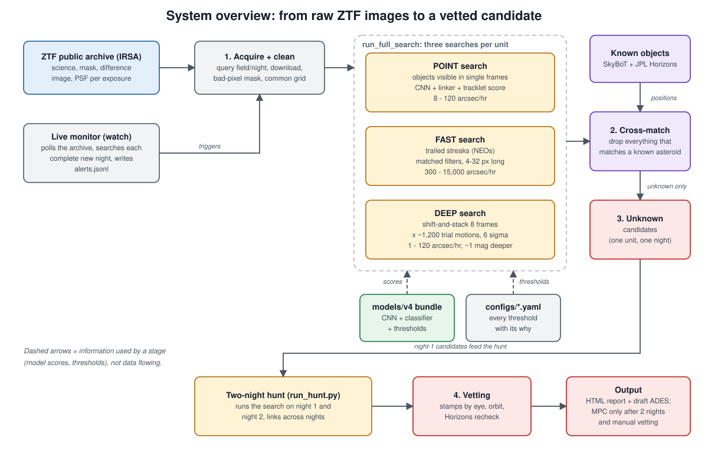
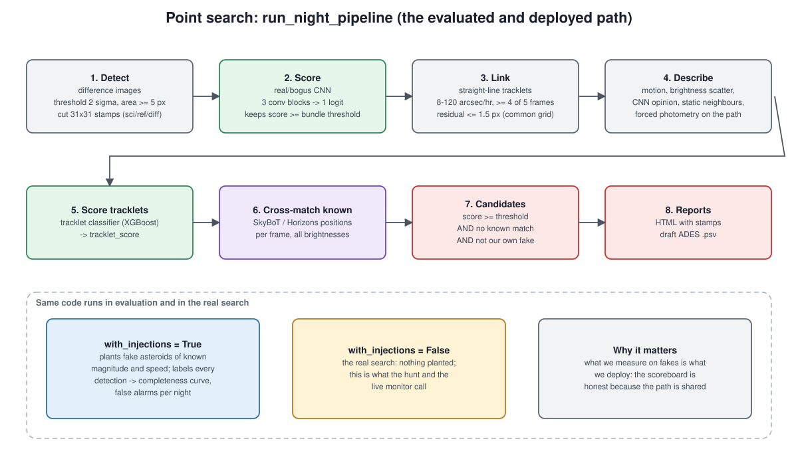
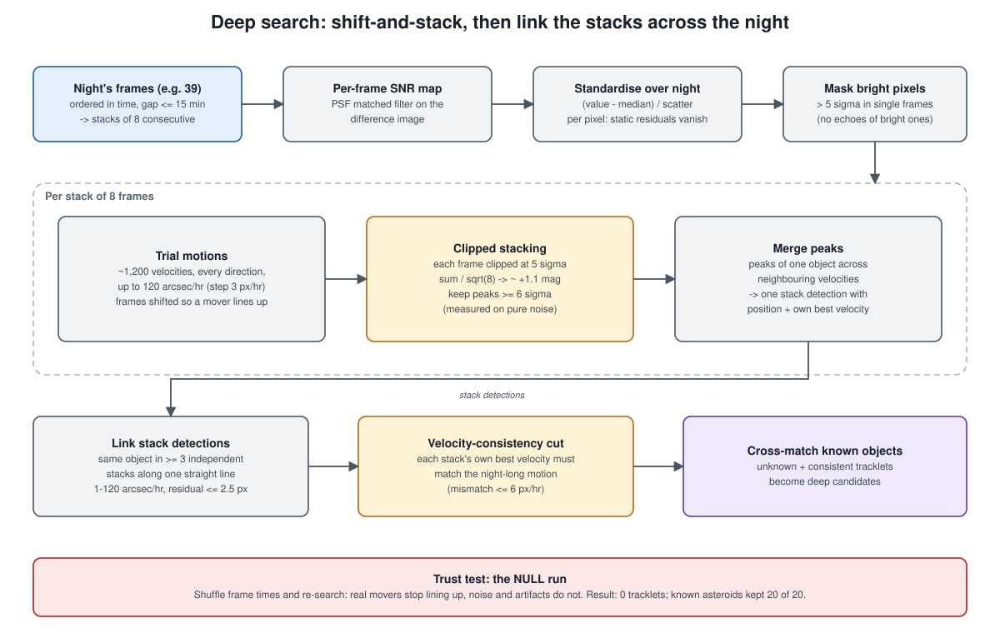
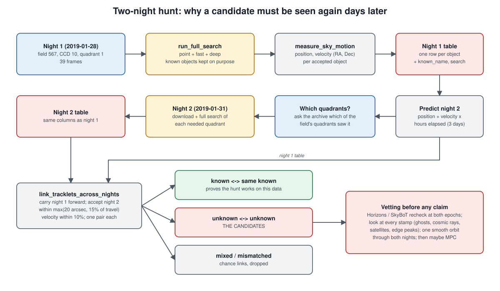
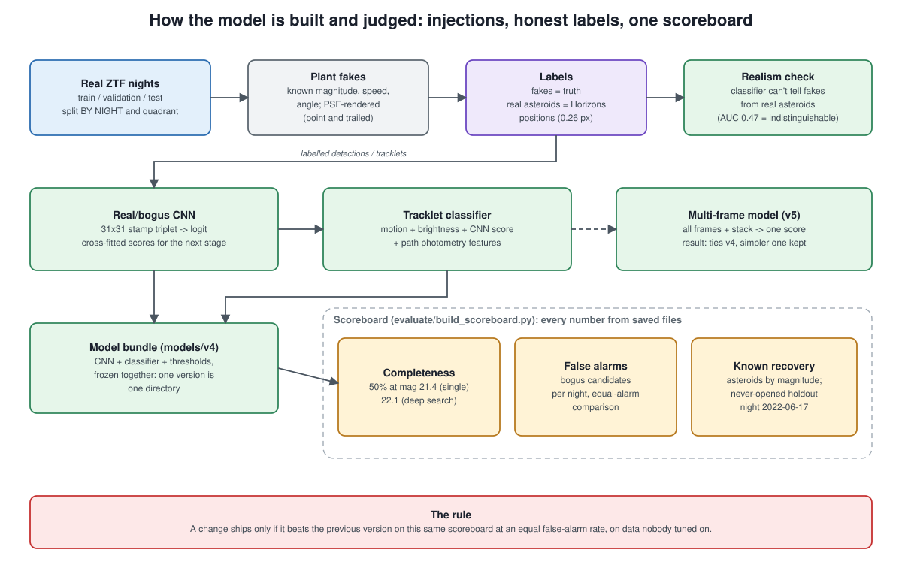

# Architecture: how the asteroid hunter works

One sentence: we download ZTF's own *difference images* (tonight minus a reference of the same sky), so everything static cancels, and look for dots that **move in a straight line across frames**. Anything that moves and matches no known asteroid is a candidate. It only counts if it shows up again on a second night.

## 1. The data
For every exposure the ZTF archive (IRSA) provides a science image, a bit mask, a difference image and a PSF model of the difference image. A **unit** is one field, one CCD, one quadrant, one night (e.g. field 567, CCD 10, quadrant 1, 2019-01-28). Everything in the system runs per unit. Nights are split into train / validation / test **by night** so nothing leaks (`configs/acquire.yaml`).

## 2. Three searches, because asteroids come in three kinds
`run_full_search` runs all three on a unit and keeps unknown objects that pass each search's own checks.

| Search | Finds | Speed range | How |
|---|---|---|---|
| **Point** | objects bright enough to see in single frames | 8-120 "/hr | detect, CNN, link, classify |
| **Fast** | near-Earth objects that trail during the 30 s exposure | 300-15,000 "/hr | matched filter for streaks 4-32 px long, link, check trail length/angle match the motion |
| **Deep** | faint objects invisible in any one frame | 1-120 "/hr | shift-and-stack, link stacks |

### Point search ([diagram](point_search.svg))

Detect blobs, score each 31x31 stamp triplet with a small CNN (real vs bogus), link plausible detections into straight-line tracklets, describe each tracklet (motion, brightness scatter, forced photometry along the path), score it with a classifier, cross-match against all known asteroids. The **same function** runs with fakes planted (evaluation) and without (real search), so measured performance is deployed performance.

### Deep search ([diagram](deep_search.svg))

A faint asteroid is below the noise in every frame, but it adds up if you shift the frames along its motion before summing. We do not know the motion, so we try about 1,200 trial velocities per stack of 8 frames (sqrt(8) = 2.8x signal-to-noise, about +1.1 mag). Safeguards that make this trustworthy: standardise every pixel over the night, hide what single frames already see, clip each frame at 5 sigma, and require the same object in at least 3 independent stacks with consistent velocity. The **null test** (shuffle frame times) gives 0 tracklets, which is how we know the peaks are not noise.

## 3. Two nights make a discovery ([diagram](two_night_hunt.svg))

A one-night candidate is easily an artifact, and the Minor Planet Center needs at least two nights anyway. `run_two_night_hunt`:
1. searches night 1 and measures each object's position and velocity;
2. predicts where each should be on night 2 and asks the archive which quadrants saw that spot (objects move about 0.75 degrees in 3 days, often into a neighbouring quadrant);
3. searches those quadrants on night 2;
4. links the nights, allowing for the path's slow curve.

Known asteroids are kept on purpose. When they link to themselves it proves the machinery works on this data, which is what makes an **unknown-unknown** link believable. Those are what we vet by hand: Horizons recheck, every stamp, orbit fit.

## 4. How the model is built and judged ([diagram](training_evaluation.svg))

We plant fake asteroids of known magnitude and speed in real images, label real asteroids with JPL Horizons positions, train the CNN and tracklet classifier, and freeze them with their thresholds as one **bundle** (`models/v4`). Fakes are checked against real asteroids (a classifier cannot tell them apart, AUC 0.47). Every change is compared on one scoreboard, at equal false alarms, on a never-opened holdout night. That discipline is why v5 (multi-frame) was *not* adopted when it only tied v4.

## 5. Running it
- One unit: `python -m asthunt.cli search --field 618 --ccd 3 --quadrant 4 --night 2019-02-08`
- Live watching: `python -m asthunt.cli watch [--once]`
- Two-night hunt: `python scripts/run_hunt.py --field 567 --ccd 10 --quadrant 1 --night 2019-01-28 --second-night 2019-01-31` (log in `logs/hunt/`); add `--light` to download no science images (60% less data) and skip the point search
- Several quadrants, politely (a dry run unless `--go`): `python scripts/run_hunt_batch.py --field 570 --night 2019-02-09 --second-night 2019-02-10 --around 10:2 --nearest 3 --light`

After the hunt, what happens to a lead (all in `scripts/`, each writes into `data/processed/`):
- `find_counterpart.py`: stack the whole of night 2 along the night-1 motion to find the object again
- `measure_track.py`: calibrated position and velocity on each night, checked against Horizons on known asteroids
- `fit_orbit.py`: does one two-body orbit fit both nights, and at what distance? (with positive and negative controls)
- `check_counterpart_significance.py`: shuffled-time noise runs and the chance of a coincidence
- `check_known_near.py`: any catalogued object near it, on both nights
- `vet_pair.py`, `make_comparison_stamps.py`: the stamps, next to known asteroids and noise
- `predict_positions.py`, `find_other_nights.py`: where it was on other dates, and which other ZTF nights cover that
- `measure_counterpart_completeness.py`: how faint a counterpart the search can see (planted fakes)
- `check_fast_tracks.py`: what the fast search's tracks are
(The detailed hunt record and reporting drafts are kept in the original project, not in this course copy.)

## What the system can and cannot claim
- Measured: 50% completeness at mag 21.4 for single frames and 22.1 for the deep search; 97% of injected fast trails recovered; 5 of 5 known asteroids linked over 3 days with no wrong link.
- ZTF's own pipeline has mined this data, so a new object is most likely faint or fast. An "unknown" only means unmatched in SkyBoT. Artifacts and catalogue gaps are the usual explanation, and nothing goes to the MPC without two nights and manual vetting.
